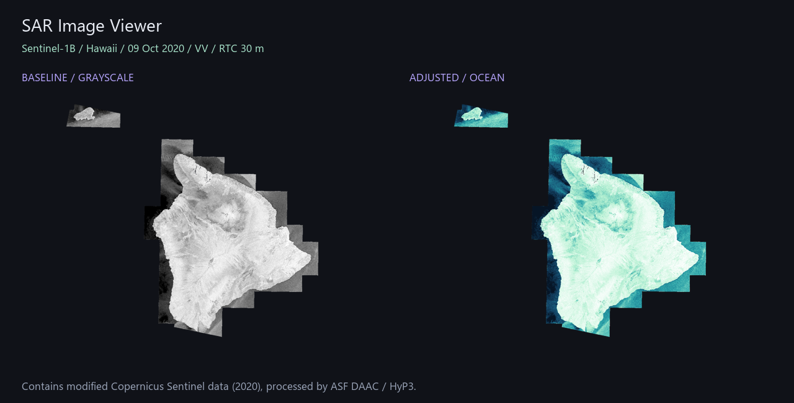

# 🛰️ SAR Image Viewer

A small Python app for exploring synthetic aperture radar GeoTIFFs. Open an image,
adjust its display, compare the result and export a PNG — no machine learning needed.

The interface is in Russian. Built with Streamlit, Rasterio, NumPy and Pillow.



*Rendering example; the application provides interactive controls alongside these views.*

## Features

- Upload a GeoTIFF or download a real Sentinel-1 Hawaii example without an account.
- Select a raster band; view dimensions, CRS, resolution and source metadata.
- Display native values or convert linear power/amplitude to decibels.
- Adjust percentile stretch, brightness, contrast and gamma; choose four palettes.
- Compare a fixed baseline with your adjustments side by side.
- Export a transparent PNG and a JSON record of display settings.
- Bound the preview to 1600 pixels on its longest side; preserve NoData masks.

## Quick start / Быстрый запуск

Python 3.10–3.13 is recommended. In a terminal opened in this project folder:

```powershell
python -m venv .venv
.venv\Scripts\python -m pip install -r requirements.txt
.venv\Scripts\python -m streamlit run app.py
```

Open http://localhost:8501. Choose **Пример · Гавайи** and click
**Скачать пример · 59 МБ**, or select **Мой GeoTIFF** to open your file.
If the sample has already been downloaded, it opens immediately, including offline.

macOS / Linux:

```bash
python3 -m venv .venv
.venv/bin/python -m pip install -r requirements.txt
.venv/bin/python -m streamlit run app.py
```

Optional download before launching:

```powershell
.venv\Scripts\python scripts/download_sample.py
```

## Where to get an image / Где взять снимок

Start with the [direct Hawaii VV GeoTIFF from ASF](https://hyp3-examples.s3.us-west-2.amazonaws.com/RTC_GAMMA/Hawaii/S1B_IW_20201009T161543_DVR_RTC30_G_gpuned_27D0/S1B_IW_20201009T161543_DVR_RTC30_G_gpuned_27D0_VV.tif).
It is a real Sentinel-1B observation from **9 October 2020**, processed to an RTC
product with 30 m pixel spacing. The file is about 59 MB. The application uses a
fixed public URL, downloads only when requested, and saves it under `data/`.

For other areas, explore [ASF Vertex](https://search.asf.alaska.edu/).
Choose a prepared RTC GeoTIFF with a VV or VH backscatter band; access to other
products may require a NASA Earthdata account. See [data/README.md](data/README.md)
for the exact example source, metadata and attribution.

## Reading the display

For the bundled sample, **Мощность → dB** uses `10 × log10(power)`.
Use **Амплитуда → dB** only for linear amplitude (`20 × log10(amplitude)`).
For data already in dB, select **Как в файле**. The app does not infer calibration
from pixel values and does not convert raw digital numbers into calibrated backscatter.

The baseline uses the selected band and scale, grayscale and a 2–98 percentile
stretch. The adjusted view adds your chosen stretch, contrast, brightness, gamma
and palette. Percentiles and valid-pixel statistics are calculated on the preview.
Complex SLC inputs are rejected. NaN, infinity and NoData are transparent; logarithmic
display also excludes non-positive values. Constant images render as mid-gray.

PNG export has **preview resolution and no georeferencing**. All adjustments affect
display only; source measurements remain unchanged. This is a viewer, not an RTC
processing pipeline or a flood classifier. Uploads are limited to 200 MB.

## Project structure

```text
app.py                     Streamlit interface
sar_viewer.py              GeoTIFF reading, rendering and sample download
scripts/download_sample.py Optional sample downloader
data/README.md             Data provenance and links
tests/                     Numerical and application smoke tests
.streamlit/config.toml     Theme and local server configuration
```

## Checks

```powershell
.venv\Scripts\python -m unittest discover -s tests -v
```

## License

Application code: [MIT](LICENSE). Source imagery retains its own terms and attribution.
